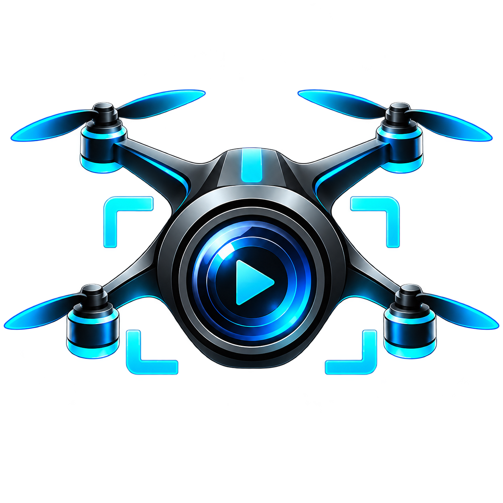
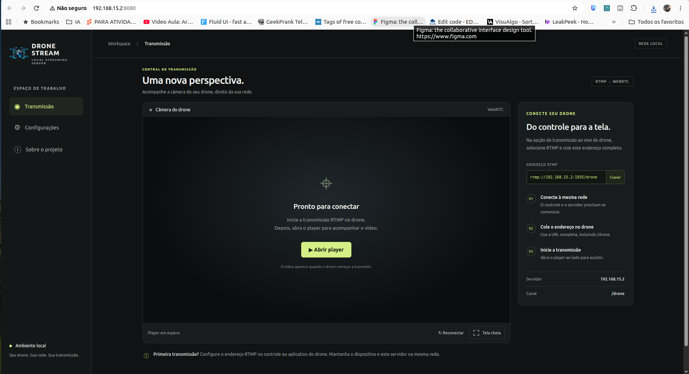
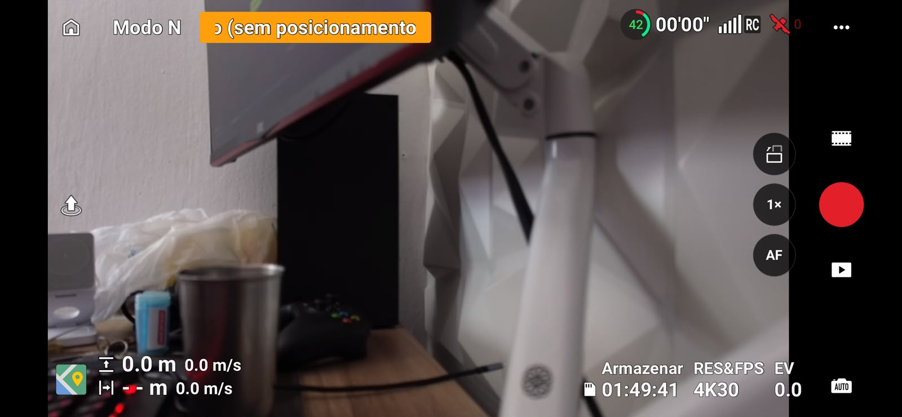
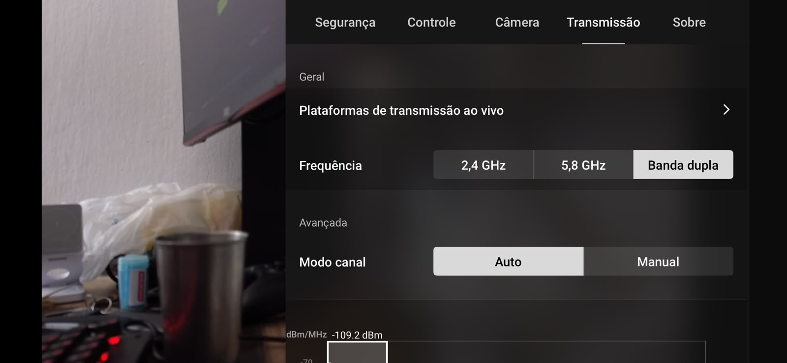
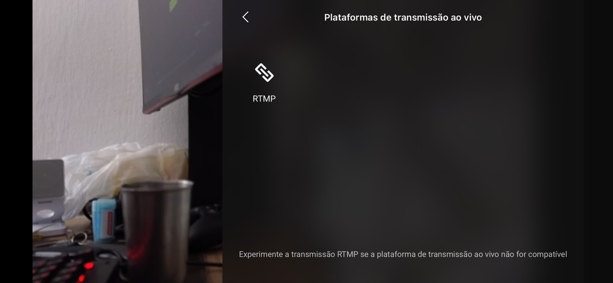
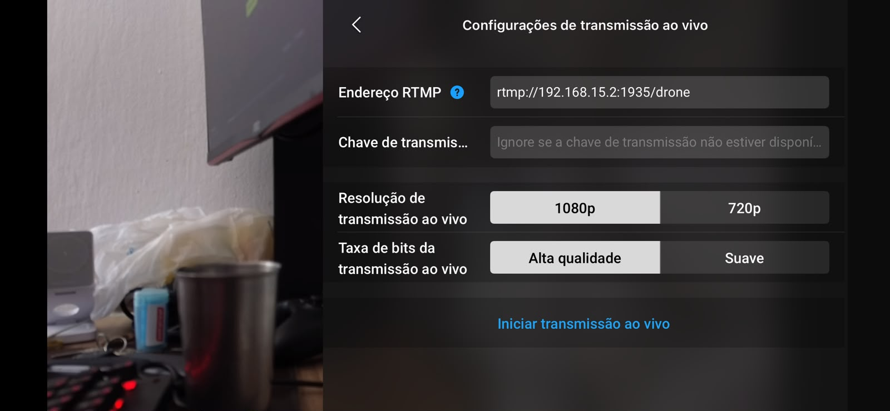

<p align="center">
  
</p>

<h1 align="center">Drone Streaming Server</h1>

<p align="center">Do controle para a tela: transmissão de vídeo de drones na sua rede local.</p>

<p align="center">
  <a href="#docker-linux">Docker / Linux</a> ·
  <a href="#windows">Windows</a> ·
  <a href="#configurar-o-drone">Configurar o drone</a> ·
  <a href="#solucao-de-problemas">Solução de problemas</a> ·
  <a href="#autor-e-contribuicao">Autor e contribuição</a>
</p>

Receba o vídeo de um drone ou dispositivo com **publicação RTMP** e acompanhe a transmissão por **WebRTC** ou **HLS**. O MediaMTX recebe e distribui o vídeo; você escolhe entre o painel web com Docker e o aplicativo desktop para Windows.



*Tela inicial do painel Docker, aguardando a publicação do drone. O IP mostrado é um exemplo da rede utilizada na demonstração.*

## Escolha sua versão

| | Docker / Linux | Windows desktop |
| --- | --- | --- |
| Como usar | Menu no terminal e painel no navegador | Programa com janela e player integrado |
| Instalador | [`install-DroneStreamingServer.sh`](install-DroneStreamingServer.sh) | [`install-windows.exe`](install-windows.exe) |
| Servidor | MediaMTX em container | MediaMTX executado diretamente pelo programa |
| Dependências | Docker Engine e Compose v2 | .NET Framework 4.7.2+ e WebView2 Runtime |
| Preparação automática | Ubuntu/Debian com systemd e root/sudo | Assistente verifica os requisitos e instala WebView2 quando necessário |
| Iniciar transmissão | Opção **2 — Iniciar servidor** | Botão **Iniciar servidor** |
| Assistir | Painel na porta `8080` | Player dentro do aplicativo |
| Ao fechar o menu/programa | O servidor continua ativo ao sair do menu | O servidor é encerrado ao fechar o aplicativo |

**Instalar não inicia a transmissão.** Em ambas as versões, você precisa escolher **Iniciar servidor** e depois iniciar a publicação no controle/aplicativo do drone.

## O que o projeto oferece

- Recepção RTMP no caminho `/drone`.
- Reprodução WebRTC e alternativa HLS.
- Endereço RTMP pronto para copiar e configurar no drone.
- Seleção ou detecção do IPv4 do servidor, evitando interfaces virtuais comuns.
- Player com opção de tela cheia.
- Configurações de reprodução e seção Sobre com informações do criador.
- Identidade visual e ícones compartilhados entre Docker e Windows.

O projeto distribui vídeo ao vivo. Não controla o drone, não configura gravação ou transcodificação e não encaminha automaticamente a transmissão para plataformas externas.

## Como funciona

```text
Drone → controle / aplicativo com RTMP → MediaMTX → WebRTC ou HLS
                                          │
                       ┌──────────────────┴──────────────────┐
                       │                                     │
                 Docker / Linux                         Windows
                Painel no navegador                Player no aplicativo
```

O computador servidor e o dispositivo que publica RTMP precisam conseguir se comunicar pela rede. O Wi-Fi usado pelo controle para alcançar o servidor não deve ser confundido com o enlace de rádio entre controle e aeronave.

<a id="docker-linux"></a>

## Docker / Linux

### 1. Baixar o projeto

Com Git instalado:

```bash
git clone https://github.com/pauloeugenio/droneStreamingServer.git
cd droneStreamingServer
```

Você também pode baixar e extrair o ZIP do repositório. Mantenha o instalador e a pasta `docker-install` juntos.

### 2. Preparar o ambiente

Na raiz do projeto, execute:

```bash
bash install-DroneStreamingServer.sh
```

O menu apresenta:

```text
1) Instalar
2) Iniciar servidor
3) Parar servidor
4) Sair
```

Escolha **1 — Instalar**. A instalação automática requer **Ubuntu ou Debian com systemd ativo**, internet e privilégios de administrador. Ela:

1. Confere os arquivos do projeto.
2. Instala `ca-certificates`, `curl`, `iproute2` e `xdg-utils`.
3. Verifica Docker e Compose v2 e, quando ausentes, prepara a instalação pelo repositório oficial Docker.
4. Habilita e inicia o serviço Docker.
5. Valida o Compose e baixa as imagens do MediaMTX e do Nginx.

Pacotes que conflitem com Docker CE são informados para revisão manual, sem remoção automática. Execute o script como seu usuário normal; ele solicita `sudo` quando necessário. O serviço Docker pode iniciar com o sistema, mas os containers deste projeto usam `restart: "no"`.

### 3. Iniciar o servidor

Escolha **2 — Iniciar servidor**. O script identifica o IPv4, inicia os containers, aguarda a resposta do painel e tenta abri-lo no navegador da sessão gráfica.

Exemplo de endereços exibidos:

```text
No controle/aplicativo do drone:
rtmp://192.168.15.2:1935/drone

No navegador:
http://192.168.15.2:8080/
```

**Substitua `192.168.15.2` pelo IP real do servidor.** Não use `localhost`, `127.0.0.1` nem o endereço de uma interface virtual no controle do drone.

Se precisar escolher o IP explicitamente:

```bash
DRONE_SERVER_IP=192.168.15.2 bash install-DroneStreamingServer.sh
```

O valor é aplicado ao endereço anunciado pelo WebRTC usando `MTX_WEBRTCADDITIONALHOSTS`. A variável antiga `DJI_SERVER_IP` continua aceita por compatibilidade.

Em SSH, sem ambiente gráfico ou executando como root, abra manualmente a URL exibida. Falhas do navegador ficam no arquivo temporário `drone-browser.*.log`, cujo caminho aparece no terminal.

### 4. Assistir e configurar

No painel:

- **Transmissão:** copie o endereço RTMP, inicie a publicação no drone e clique em **Abrir player**. Use **Reconectar** se necessário e **Tela cheia** para ampliar o vídeo.
- **Configurações:** altere o IP de destino, o protocolo WebRTC/HLS e a abertura automática do player. Essas preferências ficam no navegador; não alteram a rede do servidor nem iniciam containers.
- **Sobre o projeto:** informações do criador, GitHub, e-mail, chave Pix e QR Code ampliável.

Para parar os serviços, volte ao menu e escolha **3 — Parar servidor**. A opção **4 — Sair** fecha apenas o menu.

### 5. Operação manual e logs

Na raiz do repositório, os comandos abaixo usam a mesma identificação de projeto do instalador:

```bash
export COMPOSE_PROJECT_NAME="$(basename "$PWD" | tr '[:upper:]' '[:lower:]')"
export DRONE_SERVER_IP=192.168.15.2

# Validar a estrutura do Compose
docker compose -f docker-install/docker-compose.yml config --quiet

# Iniciar os serviços
docker compose -f docker-install/docker-compose.yml up -d

# Consultar estado e acompanhar logs
docker compose -f docker-install/docker-compose.yml ps
docker compose -f docker-install/docker-compose.yml logs -f mediamtx

# Parar os serviços
docker compose -f docker-install/docker-compose.yml stop
```

Ajuste o IP antes de iniciar. Se seu usuário não tiver acesso ao Docker, prefira o menu, que trata o uso de `sudo`. `Ctrl+C` encerra o acompanhamento dos logs sem parar o servidor.

**Renomeou a pasta de uma instalação existente?** O instalador deriva o nome do projeto Compose da pasta raiz. Se os containers foram criados quando a pasta ainda se chamava `djiStreamingServer`, use `COMPOSE_PROJECT_NAME=djistreamingserver bash install-DroneStreamingServer.sh` para continuar gerenciando aquele projeto. Isso evita criar outro conjunto com conflito no nome `drone-mediamtx` e nas portas. Não é necessário fazer isso em uma instalação nova de `droneStreamingServer`.

Referência detalhada dos arquivos YAML, volumes e comandos: [guia Docker](docs/docker.md).

<a id="windows"></a>

## Windows

### 1. Instalar o aplicativo

Baixe o arquivo [`install-windows.exe`](install-windows.exe) na raiz do repositório e execute o assistente. Para instalar, você não precisa copiar os fontes de `windows-install` nem instalar Docker, WSL, Python ou Node.js.

Requisitos:

- **Windows 10 ou 11 x64**, para processadores Intel/AMD de 64 bits.
- **.NET Framework 4.7.2 ou posterior**, verificado pelo instalador. Se ausente, atualize pelo Windows Update antes de continuar.
- **Microsoft Edge WebView2 Runtime**, instalado pelo bootstrapper oficial quando necessário. Essa etapa requer internet; com o runtime presente, a instalação pode ser feita offline.

O assistente instala por usuário em `%LOCALAPPDATA%\Programs\DroneStreamingServer` e cria atalhos na área de trabalho e no menu Iniciar. Não instala um serviço nem abre automaticamente o servidor.

### 2. Configurar e iniciar

1. Abra **Drone Streaming Server** pelo atalho.
2. Em **Configurações**, confira o IPv4 da rede acessível pelo controle do drone. Selecione WebRTC ou HLS e salve as preferências.
3. Volte para **Transmissão** e clique em **Iniciar servidor**.
4. Copie o endereço RTMP exibido e configure o drone conforme o [passo a passo abaixo](#configurar-o-drone).
5. Inicie a publicação no drone. O vídeo aparece no player integrado, sem abrir um navegador externo.

No primeiro uso, o Windows pode pedir autorização de firewall para `mediamtx.exe`. Permita o acesso pela rede privada utilizada pelo drone. O programa verifica conflitos de portas e não encerra servidores de outros aplicativos.

### 3. Reprodução, parada e atualização

- Use **Reconectar vídeo** para recarregar o player.
- Use o botão do player, **Tela cheia** ou **F11** para expandir; **Esc** ou **F11** para voltar.
- Para alterar a rede ou o protocolo, pare o servidor antes de mudar as configurações.
- **Parar servidor** encerra o MediaMTX. Fechar o aplicativo também encerra o processo iniciado por ele.
- Para atualizar, feche o programa e execute novamente `install-windows.exe`.

Logs, preferências, configuração gerada e perfil do player ficam em `%LOCALAPPDATA%\DroneStreamingServer`. A seção Configurações tem um botão para abrir essa pasta. A desinstalação preserva esses dados e não remove o WebView2 Runtime compartilhado.

O instalador distribuído não tem assinatura Authenticode. O autor confirmou o funcionamento da versão Windows; novas versões e mudanças no player devem ser verificadas novamente com o equipamento utilizado.

Detalhes do código, empacotamento e dependências: [guia Windows](windows-install/README.md).

<a id="configurar-o-drone"></a>

## Configurar o drone: passo a passo no DJI

As capturas abaixo foram fornecidas pelo criador e mostram uma configuração real no controle/aplicativo DJI. Os nomes dos menus e os recursos disponíveis variam com o equipamento, o firmware e a versão do aplicativo. O requisito é oferecer **RTMP personalizado**; o projeto não depende de um único modelo de drone.

Antes de configurar, inicie o servidor na versão escolhida e copie a URL RTMP exibida. O endereço `192.168.15.2` das imagens é apenas o exemplo da demonstração.

### 1. Abrir as configurações da câmera

Na visualização da câmera, toque no menu de **três pontos**, no canto superior direito.



### 2. Acessar as plataformas de transmissão ao vivo

Abra a aba **Transmissão** e selecione **Plataformas de transmissão ao vivo**.



### 3. Selecionar RTMP

Na lista de plataformas, escolha **RTMP**.



### 4. Informar o endereço do servidor

Em **Endereço RTMP**, cole a URL completa exibida pelo software, por exemplo:

```text
rtmp://192.168.15.2:1935/drone
```

Na configuração mostrada, a URL já contém o caminho `/drone` e o campo **Chave de transmissão** fica vazio. O projeto não configura uma chave adicional. Não acrescente `/live` nem repita `/drone` no campo de chave.

Escolha a resolução e a taxa de bits conforme as opções do equipamento e a capacidade da rede; então toque em **Iniciar transmissão ao vivo**. A captura mostra `1080p` e `Alta qualidade` selecionados, como exemplo, não como requisitos do servidor.



### 5. Confirmar a chegada do vídeo

No Docker, abra o painel e clique em **Abrir player**. No Windows, acompanhe o player integrado após iniciar o servidor. Se o vídeo não aparecer, confirme a publicação no DJI, confira os logs e tente reconectar o player.

Um servidor em execução ou um player aberto não comprovam que já existe publicação de vídeo. O player começa sem áudio para facilitar a reprodução automática.

<a id="rede-e-enderecos"></a>

## Rede, portas e endereços

| Porta | Protocolo | Finalidade | Versões |
| --- | --- | --- | --- |
| `1935` | TCP | Receber publicação RTMP | Docker e Windows |
| `8888` | TCP | Player e playlist HLS | Docker e Windows |
| `8889` | TCP | Player e sinalização WebRTC | Docker e Windows |
| `8189` | UDP | Mídia WebRTC / ICE | Docker e Windows |
| `8080` | TCP | Painel web Nginx | Docker |

| Uso | Exemplo de endereço |
| --- | --- |
| Publicação no drone | `rtmp://192.168.15.2:1935/drone` |
| Painel Docker | `http://192.168.15.2:8080/` |
| Player WebRTC direto | `http://192.168.15.2:8889/drone/` |
| Player HLS direto | `http://192.168.15.2:8888/drone/` |
| Playlist para player HLS compatível | `http://192.168.15.2:8888/drone/index.m3u8` |

Use o IPv4 da interface física conectada à rede do controle, como Wi-Fi ou Ethernet. Em Windows, o player embutido usa o loopback internamente; o endereço que deve ser configurado no drone continua sendo o IPv4 da rede.

O acesso está preparado para **rede local**, sem autenticação/TLS configurados para os endereços acima. Publicação pela internet exige configuração adicional de acesso, roteamento e conectividade WebRTC. Docker e Windows usam as mesmas portas: não execute os dois servidores simultaneamente no mesmo computador.

## Estrutura do repositório

```text
droneStreamingServer/
├── README.md                         # Guia principal
├── install-DroneStreamingServer.sh    # Menu de instalação/operação Linux
├── install-windows.exe               # Instalador desktop Windows
├── docs/
│   ├── docker.md                     # Referência técnica Docker
│   └── images/                       # Capturas do painel e do controle DJI
├── docker-install/
│   ├── docker-compose.yml            # MediaMTX + Nginx
│   ├── mediamtx.yml                   # Protocolos e caminho /drone
│   ├── tests/web.test.cjs             # Testes da lógica do painel
│   └── web/                          # HTML, CSS, JavaScript e imagens
└── windows-install/
    ├── README.md                     # Guia técnico Windows
    ├── src/                          # Aplicativo C# / WinForms / WebView2
    ├── tests/                        # Testes de configuração e preferências
    ├── assets/                       # Logomarca, ícones e QR Code Pix
    ├── installer.nsi                  # Instalador/desinstalador NSIS
    ├── prepare.py                    # Preparação e verificação de dependências
    ├── build.sh                      # Compilação e empacotamento
    ├── dependencies.json             # Versões e hashes das dependências
    └── installer.sha256              # Hash do instalador distribuído
```

### Configurações e personalização

| Arquivo | O que configura |
| --- | --- |
| `docker-install/docker-compose.yml` | Imagens, serviços, portas, volumes e variável de endereço WebRTC |
| `docker-install/mediamtx.yml` | Protocolos e caminho de publicação do MediaMTX |
| `docker-install/web/about.json` | Nome do criador, descrição, e-mail, GitHub e chave Pix do painel |
| `docker-install/web/assets/` | Logomarca, favicon e QR Code do painel |
| `windows-install/about.json` | Perfil e contribuição incluídos na distribuição Windows |
| `windows-install/assets/` | Logomarca, ícone Windows e QR Code incluídos no instalador |

No Windows instalado, `about.json` pode ser personalizado e é preservado em atualizações. O programa usa `about-defaults.json` para preencher o Pix vazio de versões anteriores. Nas duas versões, o QR Code fornecido só é exibido quando corresponde à chave Pix configurada.

O painel web não precisa de compilação. Após editar seus arquivos, atualize o navegador com **Ctrl+F5**. Mudanças no aplicativo Windows exigem gerar novamente o instalador.

## Desenvolvimento e verificação

Execute os comandos abaixo na raiz do repositório.

```bash
# Sintaxe do instalador Linux
bash -n install-DroneStreamingServer.sh

# Lógica do painel web — requer Node.js somente para este teste
node docker-install/tests/web.test.cjs

# Estrutura da configuração Docker
docker compose -f docker-install/docker-compose.yml config --quiet

# Integridade do instalador Windows
sha256sum -c windows-install/installer.sha256
```

Para compilar o Windows em ambiente Linux com Docker:

```bash
docker build -t drone-windows-builder -f windows-install/Dockerfile.build windows-install
docker run --rm --user "$(id -u):$(id -g)" -v "$PWD:/work" drone-windows-builder
```

O processo baixa e verifica as dependências oficiais, compila o aplicativo C#, executa os testes e gera o `install-windows.exe` na raiz. Downloads e binários intermediários são ignorados pelo Git. Mais detalhes estão no [guia Windows](windows-install/README.md#fontes-e-compilação).

Os testes automatizados verificam a lógica da interface, URLs, IPv4, configuração e preferências. Eles não substituem testar a transmissão real, os codecs e a tela cheia no sistema de destino.

<a id="solucao-de-problemas"></a>

## Solução de problemas

| Sintoma | Verificação |
| --- | --- |
| O drone não conecta | Confirme o IPv4, a porta TCP `1935`, o caminho `/drone`, o firewall e a comunicação entre os dispositivos. |
| O painel abre, mas não há vídeo | Inicie a publicação no drone e abra/reconecte o player. Confira se os logs indicam um publicador em `drone`. |
| HLS funciona, mas WebRTC não | Confira o IP anunciado, a porta UDP `8189`, isolamento de clientes Wi-Fi e suporte do codec. |
| A imagem trava | Confira a qualidade da rede e experimente reduzir a resolução ou a taxa de bits no controle. |
| O navegador não abre sozinho | Execute o menu como usuário normal em uma sessão gráfica. Abra a URL manualmente e consulte o log `drone-browser.*.log`. |
| O Windows não carrega o player | Verifique/reinstale o WebView2 Runtime e abra novamente o aplicativo. |
| As portas já estão ocupadas | Pare outra instância do MediaMTX ou os containers da outra versão antes de iniciar. |
| O endereço mudou | Atualize o IP e reinicie o servidor; no Docker, use `DRONE_SERVER_IP` se necessário. |
| A pasta do projeto foi renomeada | Verifique a identificação `COMPOSE_PROJECT_NAME` da instalação anterior, conforme explicado na seção Docker. |
| A atualização visual não aparece | No painel Docker, use **Ctrl+F5**. No Windows, feche o aplicativo e reinstale o EXE atualizado. |

## Referências

- [MediaMTX — documentação e instalação](https://mediamtx.org/docs/kickoff/install).
- [MediaMTX — reprodução e integração com navegadores](https://mediamtx.org/docs/read/web-browsers).
- [Docker Engine — Ubuntu](https://docs.docker.com/engine/install/ubuntu/) e [Debian](https://docs.docker.com/engine/install/debian/).
- [Microsoft — distribuição do WebView2 Runtime](https://learn.microsoft.com/en-us/microsoft-edge/webview2/concepts/distribution).
- [DJI — guia de transmissão no DJI Fly](https://repair.dji.com/help/content?customId=en-us03400006727&documentType=artical&lang=en&paperDocType=paper&re=US&spaceId=34).

<a id="autor-e-contribuicao"></a>

## Autor e contribuição

Desenvolvido por **Paulo Eugenio**.

- GitHub: [github.com/pauloeugenio](https://github.com/pauloeugenio).
- Contato: [pauloeugenio@hotmail.com.br](mailto:pauloeugenio@hotmail.com.br).
- Repositório: [pauloeugenio/droneStreamingServer](https://github.com/pauloeugenio/droneStreamingServer).

Sugestões, relatos de problemas e contribuições de código são bem-vindos pelo repositório. Ao reportar um problema, informe a versão utilizada, o sistema operacional e o trecho relevante dos logs.

Se o projeto foi útil para você, considere apoiar seu desenvolvimento com uma contribuição voluntária via Pix.

**Chave Pix aleatória:**

```text
d1d04da4-56a0-4216-a83d-d24a2ff0d9ff
```


Obrigado por ajudar esta ideia a voar.
